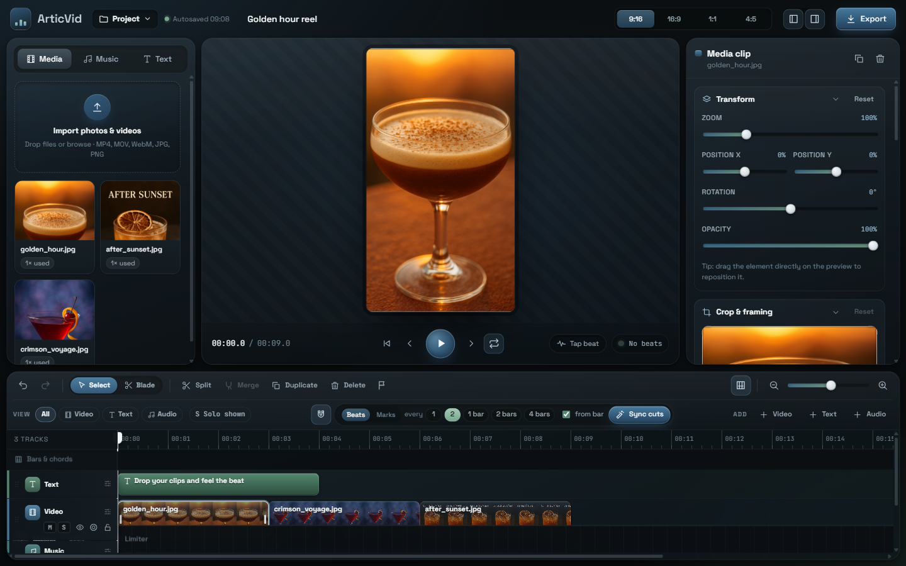
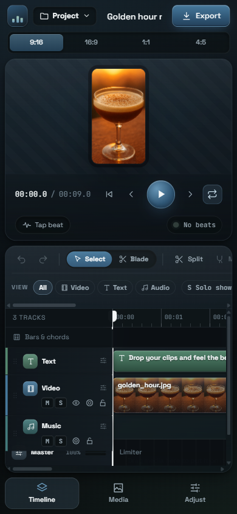
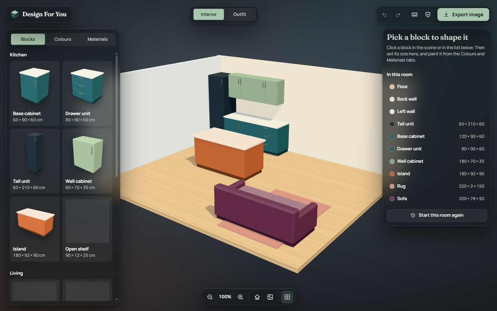
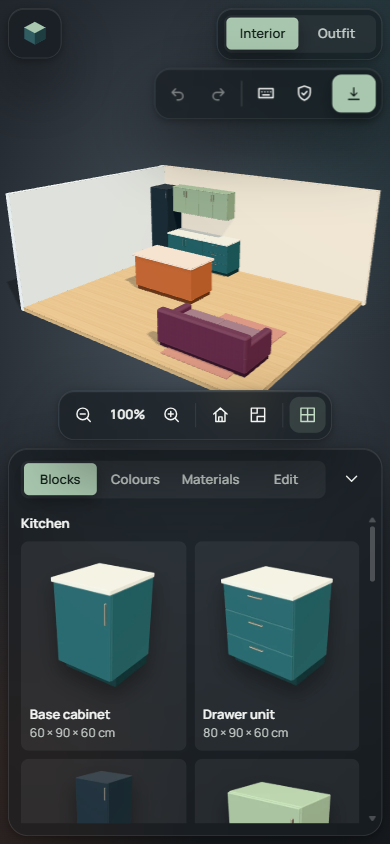
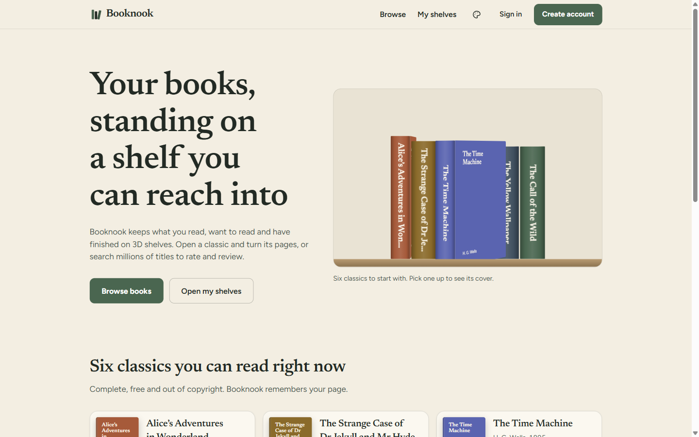
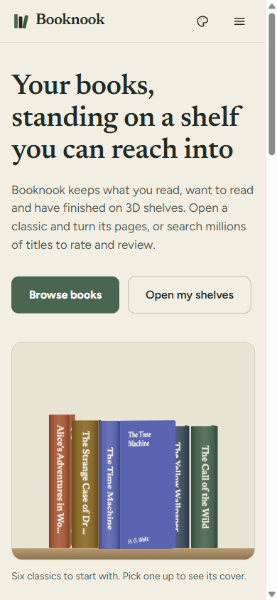
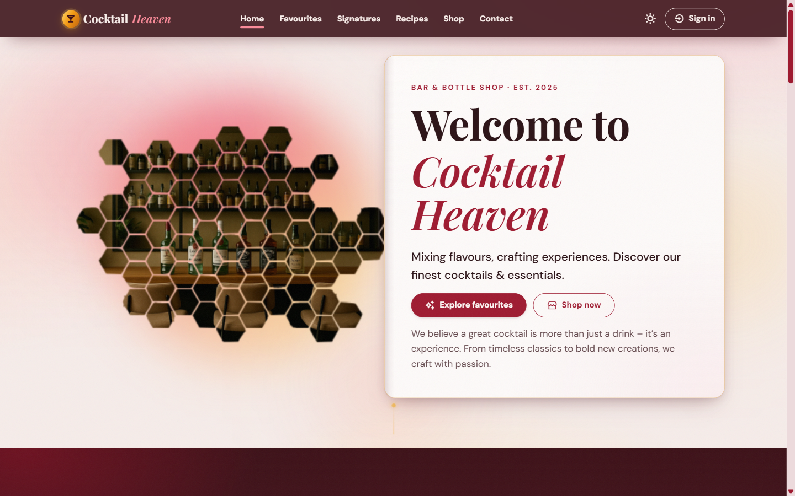
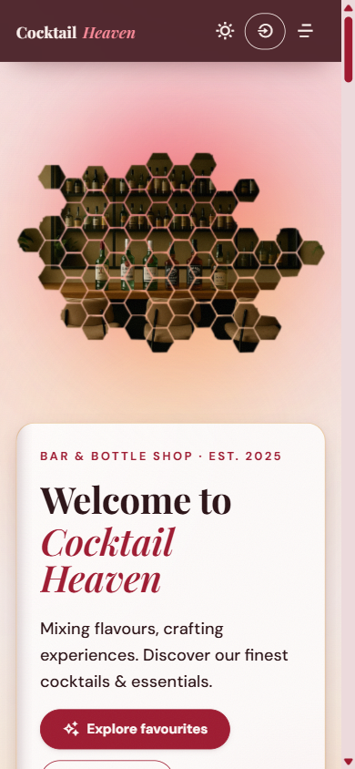

# Website templates

Four separate websites, one per folder. Each folder has its own dependencies, its own README and its own dev server. Nothing is shared between them, so you can copy any one folder out and run it on its own.

| Site | What it is | Stack |
| --- | --- | --- |
| [ArticVid](#articvid) | A beat-synced video editor that runs in the browser | React 19, TypeScript, Vite, GSAP |
| [Design For You](#design-for-you) | A 3D studio for planning a room or an outfit | Vue 3, Three.js, Vite |
| [Booknook](#booknook) | A reading corner with 3D shelves and page turns | Angular 22, Tailwind CSS 4, GSAP |
| [Cocktail Heaven](#cocktail-heaven) | A cocktail bar and shop with three themes | React 19, Vite |

## Run a site

Every site follows the same two steps: open its folder, install, then start the dev server.

```bash
cd text-to-video        # or design_for_you, booknook, cocktail_website
npm install             # run again whenever package.json changes
npm run dev             # Booknook uses: npm start
```

Booknook needs Node.js 22.22.3 or newer. The other three run on Node.js 20 or newer.

---

## ArticVid

**Folder:** [`text-to-video/`](text-to-video/) · [README](text-to-video/README.md) · [Docs](text-to-video/docs/README.md)

A short-form video editor in the spirit of CapCut. Import photos, videos and songs, and the cuts, zooms and words land on the beat. Everything runs on your device, from import to the finished MP4. Nothing is uploaded.

- Multi-track timeline with snapping to beats, marks and clip edges, and a preview of where a dragged clip will land
- Automatic BPM and beat detection, beat matching across songs, and AI stem splitting
- Text that reveals and moves on the beat, plus automatic captions
- Export to MP4, GIF, stills and audio
- Works on phones: the preview stays on top and a tab bar switches between the timeline, media and clip settings

<p>
  
  
</p>

## Design For You

**Folder:** [`design_for_you/`](design_for_you/) · [README](design_for_you/README.md)

A 3D studio for planning a room or putting together an outfit. Place blocks, drag them into position, resize them and paint them with your own colours and materials. Your work stays in your browser; there is no account and no outside service.

- Blocks that rebuild at their real size: a wider cabinet gains doors instead of stretching one
- Snap-to-grid dragging with the pointer or the arrow keys
- Colour tints, shades and suggested matches, saved palettes and photo materials
- Plan view, orbit and zoom, and PNG export of the view
- Fully usable from the keyboard

<p>
  
  
</p>

## Booknook

**Folder:** [`booknook/`](booknook/) · [README](booknook/README.md)

A reading corner in the browser. Keep your books on 3D shelves, read classics page by page with an animated page turn, and rate and review what you read. Built mobile-first.

- CSS 3D shelves where each book swings out to show its cover
- A reader with 3D page turns, three typefaces and five text sizes, which remembers your place
- Live search of the Open Library catalogue
- Ratings, reviews, sign-in and three colour themes

Accounts and data are stored in the browser only; see the Booknook README for what a real backend would need to replace.

<p>
  
  
</p>

## Cocktail Heaven

**Folder:** [`cocktail_website/`](cocktail_website/) · [README](cocktail_website/README.md)

A bar and bottle shop site with favourites, signature drinks, recipes and a shop. It has three themes: light, dark, and an accessible theme with larger type and higher contrast.

- Responsive layout with a fixed header and a menu for small screens
- Theme switcher built on CSS custom properties
- Sign-in and sign-up buttons that follow the signed-in state

<p>
  
  
</p>

---

## Repository layout

```text
website_templates/
  text-to-video/      ArticVid
  design_for_you/     Design For You
  booknook/           Booknook
  cocktail_website/   Cocktail Heaven
  screenshots/        Images used in this README
  CLAUDE.md           Design and code rules shared by every site
```

## Licence

[MIT](LICENSE). Each site's README lists the licences of the fonts, images and texts it bundles.
